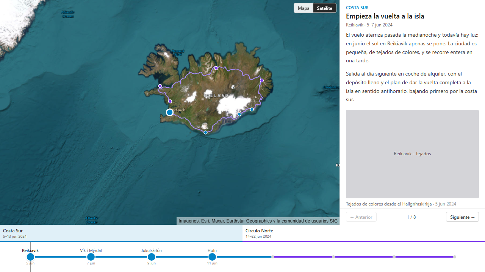

# TripMap

Sitio estático para visualizar viajes: un mapa interactivo con la ruta y las
paradas, y una línea de tiempo sincronizada con él. Sirve para cualquier viaje
que se pueda contar como una secuencia de paradas, desde una vuelta a un país
hasta un recorrido de varios años. Todo el contenido vive en el repositorio y
se resuelve en tiempo de build; no hay backend, ni base de datos, ni usuarios.

🌍 **https://unaibermudez.github.io/TripMap/**



## Qué hace

- **Mapa** con la ruta completa en gris, la ya recorrida en color y una parada
  por punto. Se puede ver sobre el mapa sobrio en grises o sobre foto de
  satélite.
- **Línea de tiempo** en dos niveles: los capítulos siempre visibles y las
  paradas del capítulo activo expandidas dentro. Se navega con click, con
  arrastre o con las flechas del teclado.
- **Panel** con el título, las fechas, el texto y las fotos de la parada activa.
  Lateral en escritorio, hoja desplegable en móvil.
- **La URL refleja la parada** como `?stop=<id>`, así que cualquier momento del
  viaje se puede enlazar y el botón de atrás funciona.

## Puesta en marcha

```bash
npm install
npm run dev
```

El sitio se sirve en **http://localhost:4321/TripMap/**. La barra final importa:
el sitio cuelga de `/TripMap/` también en local, para que el desarrollo vea las
mismas URLs que GitHub Pages.

| Comando | Qué hace |
| --- | --- |
| `npm run dev` | Servidor de desarrollo |
| `npm run build` | Build de producción en `dist/` |
| `npm run preview` | Sirve el build |
| `npm run test` | Vitest, una pasada |
| `npm run test:watch` | Vitest en watch |
| `npm run test:e2e` | Playwright: layout en escritorio y móvil, con capturas en `e2e/screenshots` |
| `npm run typecheck` | `astro check` + `tsc --noEmit` |

## Añadir contenido

Las tres entidades están en `src/data`, en TypeScript plano:

- `stops.ts` — las paradas, **en orden de viaje**. Su posición en el array es el
  orden canónico; las fechas son etiquetas, no ordenan nada.
- `legs.ts` — un tramo por cada par de paradas consecutivas. La ruta se genera
  de las coordenadas y se suaviza con un spline: el array `via` está solo para
  corregir los tramos donde la curva se va por donde no se pasó.
- `chapters.ts` — los capítulos, con su color.

Las fotos van en `public/photos` y se referencian desde la parada con su ruta
absoluta (`/photos/loquesea.svg`), su pie y sus dimensiones, que son
obligatorias para reservar el hueco antes de que carguen.

Al arrancar, el loader valida los datos con Zod y falla con un error que nombra
lo que está mal: ids repetidos, un capítulo sin paradas, paradas de un mismo
capítulo no contiguas o una cadena de tramos que no cuadra con el orden de las
paradas.

## Cómo está hecho

Astro con una única isla de React, TypeScript estricto, MapLibre GL JS, Turf,
Zustand, Zod, Tailwind, Vitest y Playwright.

Hay **un solo estado central** (Zustand). El mapa, la línea de tiempo y el panel
leen de él y escriben en él, y nunca se hablan entre ellos: todas las formas de
navegar acaban cambiando el mismo índice de parada. La lógica pura vive en
`src/lib` y se prueba sin DOM.

El razonamiento detrás de cada decisión —por qué el spline se calcula por tramo,
por qué la escala de la línea de tiempo es uniforme, por qué el panel no flota
sobre el mapa— está en **[docs/SPEC.md](docs/SPEC.md)**.

## Despliegue

Cada push a `main` dispara el workflow de GitHub Actions, que pasa `typecheck` y
los tests antes de construir y publicar en GitHub Pages. Los tests de Playwright
no van en CI: necesitan navegador y descargan el basemap de un CDN en cada
pasada. Se ejecutan en local antes de tocar el layout.

## Atribución

El basemap sobrio es [CARTO Positron](https://carto.com/basemaps/), con datos de
[OpenStreetMap](https://www.openstreetmap.org/copyright). Las imágenes de
satélite son de Esri, Maxar y Earthstar Geographics. La atribución se muestra en
el mapa y no se puede quitar: es la condición de uso de los tres.
